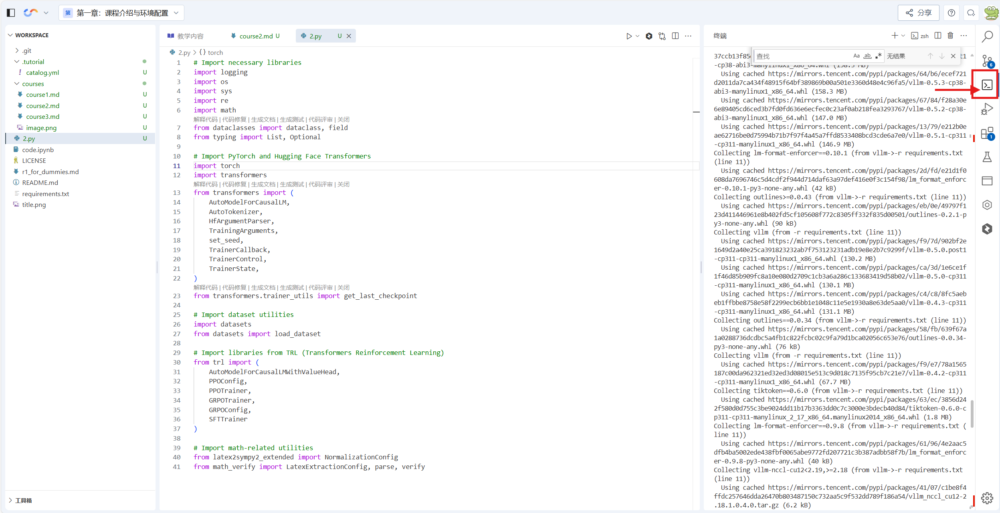

单击进入终端


在终端使用以下命令安装所需的库（运行时长比较久，我们可以选择不执行）：

```bash
pip install -r requirements.txt
```

由于代码比较分散所以当我们需要的xxx库的时候，我们再单独安装，这样比较快速。

现在，让了解我们后续会用到的库（PS：只是了解哦）。

```python
# Import necessary libraries
import logging
import os
import sys
import re
import math
from dataclasses import dataclass, field
from typing import List, Optional

# Import PyTorch and Hugging Face Transformers
import torch
import transformers
from transformers import (
    AutoModelForCausalLM,
    AutoTokenizer,
    HfArgumentParser,
    TrainingArguments,
    set_seed,
    TrainerCallback,
    TrainerControl,
    TrainerState,
)
from transformers.trainer_utils import get_last_checkpoint

# Import dataset utilities
import datasets
from datasets import load_dataset

# Import libraries from TRL (Transformers Reinforcement Learning)
from trl import (
    AutoModelForCausalLMWithValueHead, 
    PPOConfig, 
    PPOTrainer, 
    GRPOTrainer, 
    GRPOConfig, 
    SFTTrainer
)

# Import math-related utilities
from latex2sympy2_extended import NormalizationConfig
from math_verify import LatexExtractionConfig, parse, verify
```